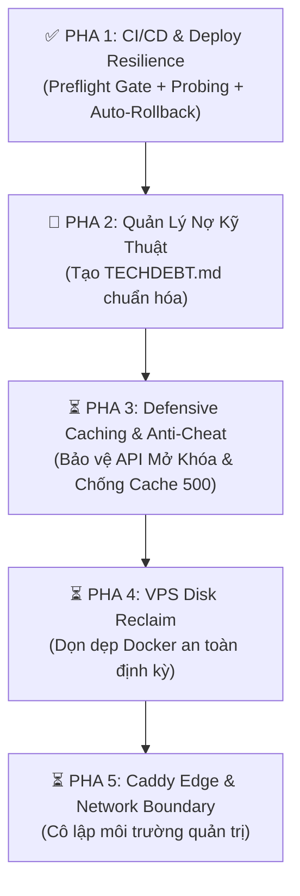

# Đặc Tả Kỹ Thuật: Kiến Trúc Gia Cố Hệ Thống & Lộ Trình Triển Khai Dần Dần

> **Tài liệu Kỹ thuật Tầng 1 (Technical Spec #13)** — Đúc kết tinh hoa kỹ thuật từ hệ thống Production `lendi_vn`, áp dụng nâng cấp độ bền vững, an ninh, vận hành VPS và quản lý nợ kỹ thuật cho `dect_project`.

---

## 🎯 1. Bối Cảnh & Mục Tiêu

Dự án `dect_project` (XPLORE) là một hệ thống web game trinh thám tương tác cao, phục vụ người chơi phá án realtime kết hợp tài liệu hồ sơ vụ án và Google Sheets Live CMS. Khi quy mô người chơi tăng và các vụ án mới (Case #001, #002...) ra đời, hệ thống đòi hỏi:

1. **Độ ổn định tuyệt đối (Zero Downtime)**: Deploy không làm gián đoạn người chơi đang phá án; tự động khôi phục (Auto-Rollback) khi có sự cố.
2. **Bảo mật & Công bằng (Anti-Cheat & Anti-Spam)**: Chặn đứng hành vi brute-force mật mã, spam request làm nghẽn server và rò rỉ dữ liệu vụ án.
3. **Vận hành VPS Bền Vững (Disk & Health Resilience)**: Ngăn chặn triệt để tình trạng tràn ổ đĩa do Docker layers, chống kẹt cache lỗi.
4. **Quản trị Nợ Kỹ Thuật Chuyên Nghiệp (Tech Debt Governance)**: Xóa bỏ các `TODO` trôi nổi, kiểm soát chặt chẽ các thành phần giao diện đang dùng mock/decorative.

---

## 💎 2. Đúc Kết Các Tinh Hoa Kỹ Thuật (Architecture Learnings Matrix)

| Lĩnh vực                       | Kỹ thuật từ `lendi_vn`                                       | Ứng dụng cụ thể vào `dect_project`                                                                      | Giá trị mang lại                                                       |
| :----------------------------- | :----------------------------------------------------------- | :------------------------------------------------------------------------------------------------------ | :--------------------------------------------------------------------- |
| **CI/CD Pipeline**             | Preflight gate, concurrency cancel, Image digest pinning     | Chặn lỗi compile TypeScript trước khi build Docker; hủy build PR thừa; lưu tag `:previous`              | Tiết kiệm 80% thời gian runner, loại bỏ hoàn toàn deploy lỗi           |
| **Zero-Downtime Deploy**       | Probing healthcheck 45s, `trap on_exit` tự động rollback     | Probe `http://127.0.0.1:3000/` sau khi `docker compose up`; nếu fail tự rollback về `:previous`         | Không bao giờ bị sập web khi bản build mới gặp lỗi runtime             |
| **VPS Disk Management**        | `docker-reclaim.sh` với điều kiện witnesses & keep-list      | Script dọn dẹp Docker có điều kiện: chỉ dọn khi container chính đang `running`, giữ lại bản `:previous` | VPS không bao giờ bị tràn ổ đĩa, không bao giờ xóa nhầm image đang cần |
| **Rate Limiting & Anti-Cheat** | Gom cụm IPv6 `/64`, caller-level throttling, docs throttling | Bọc rate limit cho các API submit password, mở khóa checkpoint, chống brute-force đáp án                | Bảo vệ tính toàn vẹn và công bằng của game trinh thám                  |
| **Defensive Caching**          | Đè `Cache-Control: no-store` cho response lỗi (500/400)      | Các route API fetch Google Sheets Live CMS / Supabase luôn gắn `no-store` khi có lỗi fetch              | Chống tình trạng trình duyệt / proxy cache lại màn hình lỗi            |
| **Log Security**               | Regex redaction toàn bộ query params trong Access Log        | Lọc sạch các access token, license key, secret parameters khỏi web server log                           | Ngăn rò rỉ thông tin nhạy cảm vào disk log                             |
| **Tech Debt Management**       | `TECHDEBT.md` chia 2 tầng, gắn ID vĩnh viễn `#ID`            | Quản lý minh bạch: Manh mối nào đang dùng mock data, nút nào chưa nối CMS, nợ refactor                  | AI Agent và dev không bị quên việc, không có mock "ma"                 |

---

## 🗺️ 3. Lộ Trình Triển Khai Từng Bước (Phased Roadmap)



---

### ✅ Pha 1: CI/CD & Deploy Resilience _(ĐÃ HOÀN THÀNH)_

- [x] **Concurrency Cancellation**: Cấu hình `concurrency` tự hủy các commit PR cũ trong `.github/workflows/deploy.yml`.
- [x] **Pre-flight TypeScript Gate**: Thêm job `preflight` chạy `npm run lint` (`tsc --noEmit`) trước khi build Docker image.
- [x] **Rollback Checkpoint**: Tạo tag backup `ghcr.io/dewey97/dect_project:previous` trên VPS trước mỗi lần pull image mới.
- [x] **Health Check Probing**: Vòng lặp thăm dò HTTP OK (15 lần x 3s = 45s).
- [x] **Tự động Rollback**: Nếu probe thất bại, in log lỗi container và lập tức bật lại image `:previous`, thoát với mã lỗi 1.
- [x] **Bảo toàn Image**: Chỉ chạy `docker image prune -f` khi và chỉ khi container mới đã verified khỏe mạnh 100%.

---

### 🎯 Pha 2: Quản Trị Nợ Kỹ Thuật Chuẩn Hóa (`docs/TECHDEBT.md`) _(TRIỂN KHAI NGAY)_

- [ ] Khởi tạo tệp tin [`docs/TECHDEBT.md`](../TECHDEBT.md) theo chuẩn Lendi:
  - **Part 1 — Blocked on Live CMS / Backend**: Danh mục các giao diện, nút bấm, manh mối hiện đang hiển thị dạng Decorative / Mock chờ dữ liệu thật từ Google Sheets.
  - **Part 2 — Codebase & Tooling Debt**: Danh mục các tác vụ dọn dẹp mã nguồn, refactor, tối ưu bundle.
- [ ] Quy ước mã số bất biến (`#ID`): Mỗi dòng nợ kỹ thuật được đánh số cố định (ví dụ `#01`, `#02`). Trong mã nguồn ghi chú theo format: `// docs/TECHDEBT.md #01`.
- [ ] Rà soát toàn bộ UI Case #000 để đánh số các điểm mock hiện hữu (ví dụ: một số hotspot khám xét lại, file audio thoại mẫu).

---

### ⏳ Pha 3: Defensive Caching & API Anti-Cheat _(BƯỚC TIẾP THEO)_

1. **Chống Cache Lỗi (Defensive Cache-Control)**:
   - Toàn bộ các API route (`app/api/...`) khi bắt được exception/lỗi fetch từ Google Sheets hoặc Supabase phải luôn trả về:
     ```ts
     headers.set("Cache-Control", "no-store, no-cache, must-revalidate");
     ```
   - Đảm bảo người chơi khi gặp chập chờn mạng chỉ cần bấm F5 là nạp lại được dữ liệu mới nhất, không bị kẹt trang lỗi trong browser cache.
2. **Rate Limiting cho các hành động giải đố (Anti-Brute Force)**:
   - Các endpoint kiểm tra mật mã két sắt, giải mã điện thoại, submit đáp án vụ án cần được bọc giới hạn:
     - Tối đa 5 lần thử / phút / IP (hoặc theo session).
     - Tránh trường hợp người chơi viết script tự động brute-force vét cạn 10.000 khả năng mật khẩu.

---

### ⏳ Pha 4: Vận Hành VPS & Tự Động Dọn Đĩa (`docker-reclaim`)

1. **Xây dựng script `scripts/ops/vps-docker-reclaim.sh`**:
   - Kiểm tra **Witnesses**: Chỉ dọn đĩa nếu container `dect_project_app` đang ở trạng thái `running`.
   - Bảo toàn **Keep List**: Luôn loại trừ image `:latest` và image `:previous` khỏi lệnh xóa.
   - Dọn dẹp an toàn các dangling build caches và orphan volumes.
2. **Cài đặt Systemd Timer trên VPS**:
   - Lên lịch chạy vào 03:00 AM hàng ngày để giải phóng ổ cứng mà không gây gián đoạn dịch vụ.

---

### ⏳ Pha 5: Caddy Edge & Ranh Giới Mạng (Network Hardening)

1. **Access Log Redaction**:
   - Nếu triển khai Caddy làm Edge Reverse Proxy phía trước Traefik, áp dụng regex filter xóa bỏ query parameters trong access log (`request>uri regexp "\?.*$" "?[redacted]"`).
2. **HSTS Header**:
   - Cấu hình `Strict-Transport-Security: max-age=31536000` đảm bảo 100% kết nối của người chơi đi qua HTTPS an toàn.

---

## 📌 4. Quy Chuẩn Duy Trì & Cam Kết Chất Lượng

- Mọi thay đổi trong kế hoạch này phải tuân thủ nguyên tắc **Strict Git Commit** và **Code-Doc Sync**.
- Tài liệu này là căn cứ kỹ thuật dài hạn để nâng cấp dần dần mà không gây xáo trộn luồng phát triển nội dung vụ án Case #000.
