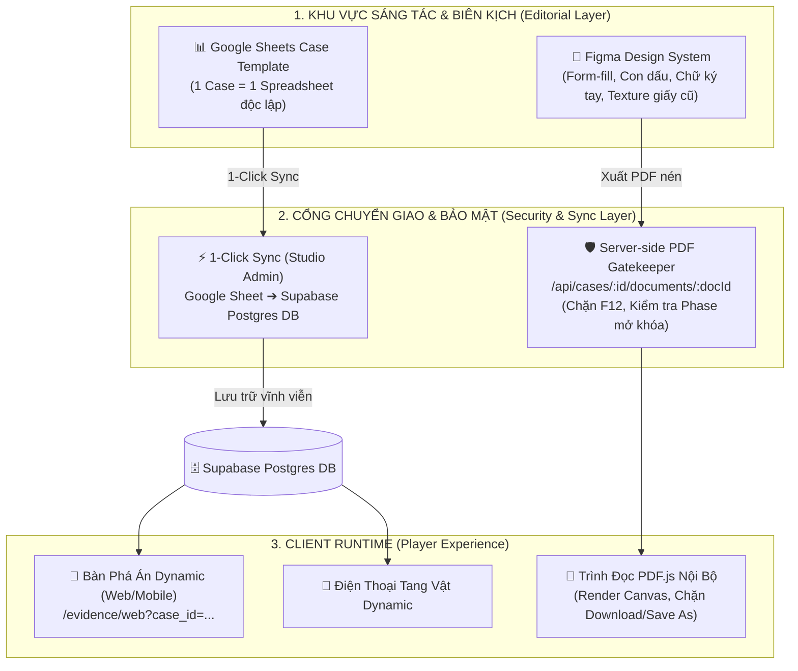

# 🏛️ ĐẶC TẢ KIẾN TRÚC MULTI-CASE ENGINE, FIGMA PIPELINE & HYBRID DATABASE CMS

> **Mã tài liệu**: `docs/core_specs/14_multi_case_engine_and_cms_architecture.md`  
> **Phiên bản**: `1.0.0` | **Trạng thái**: Đã phê duyệt (Approved Blueprint)  
> **Phạm vi**: Chuẩn hóa toàn diện kiến trúc đa vụ án (Multi-Case), quy trình tài liệu đồ họa Figma ➔ PDF, cơ chế bảo mật chống rò rỉ kịch bản (Zero-Leak Gatekeeper) và mô hình Hybrid Database CMS cho Non-tech.

---

## 🧭 1. TỔNG QUAN CHIẾN LƯỢC KIẾN TRÚC

Hệ thống **dect_project** phát triển từ một vụ án đơn lẻ (`case_000`) thành **Nền Tảng Trinh Thám Đa Vụ Án (Multi-Case Detective Engine)** độc lập và có khả năng mở rộng không giới hạn.



---

## 🎨 2. QUY TRÌNH THIẾT KẾ TÀI LIỆU FIGMA & BẢO MẬT CHỐNG LEAK

### 2.1. Đánh giá & Chuẩn hóa Figma Document Pipeline
- **Thay thế LaTeX / Google Docs bằng Figma**:
  - Tối đa hóa tính thẩm mỹ trinh thám (Skeuomorphic Realism): con dấu mộc đỏ Công an có độ nhòe mực, chữ ký tay, nẹp ghim bấm, vết ố cà phê, nếp gấp biên bản giấy cũ.
  - Sử dụng plugin điền dữ liệu tự động (*Google Sheets Sync*, *Content Reel* hoặc *Automator*) để fill thông tin nhân chứng/nghi phạm từ Sheet vào Frame văn bản hàng loạt.
- **Tiêu chuẩn xuất bản PDF từ Figma**:
  - **Giữ Live Text**: Tuyệt đối không flatten chữ thành ảnh bitmap để người chơi vẫn bôi đen copy mã số/SĐT được.
  - **Tối ưu dung lượng (Zero-Bloat Rule)**: Export với asset 2x, chạy qua script nén tối ưu (kích thước mỗi file PDF $\le 1.5\text{MB}$ thay vì $15\text{MB}$).

### 2.2. Cơ chế Bảo mật Chống Rò Rỉ Kịch Bản (Zero-Leak Gatekeeper)
> [!CAUTION]
> **Tuyệt đối CẤM truyền link Google Drive công khai (`view?usp=sharing`) xuống Client.**
> Người chơi chỉ cần nhấn `F12` (Network / Elements tab) là có thể xem trước toàn bộ file PDF của Phase 3 (Bản tự thú, Biên bản nhận tội), phá vỡ trải nghiệm phá án.

**Giải pháp kỹ thuật chuẩn hóa**:
1. **Endpoint Stream Ẩn Danh**: Client chỉ gọi API nội bộ:
   ```http
   GET /api/cases/:caseId/documents/:docId
   ```
2. **Kiểm tra Tiến Trình (Phase Guard)**:
   - Server đọc session người chơi. Nếu tài liệu thuộc `Phase 2` nhưng người chơi mới ở `Phase 0`, server trả về:
     ```json
     { "success": false, "error": "DOCUMENT_CLASSIFIED", "message": "Tài liệu này chưa được giải mật!" }
     ```
3. **Render PDF.js Canvas**:
   - Trình duyệt hiển thị PDF qua thư viện `pdfjs-dist` vẽ trực tiếp lên `<canvas>`, ẩn toàn bộ thanh công cụ tải xuống của trình duyệt và vô hiệu hóa chuột phải Save As.

---

## 📊 3. MÔ HÌNH QUẢN TRỊ DỮ LIỆU ĐA VỤ ÁN (MULTI-CASE DATA MODEL)

### 3.1. Quyết định: Mỗi Case 1 Google Sheet Độc Lập
- **Nguyên tắc**: Không gộp chung mọi case vào 1 file Sheet lớn để tránh hoa mắt, tránh sửa nhầm dòng và đảm bảo phân quyền an toàn khi có nhiều biên kịch.
- **Quy trình**:
  1. Nhân bản từ **`Case_Template_Master`**.
  2. Nhập dữ liệu cho case mới.
  3. Lấy `Spreadsheet ID` (hoặc URL) dán vào Studio Admin của vụ án đó.

### 3.2. Định hướng Database CMS: Mô hình Hybrid (Sheets Editor ➔ Supabase Postgres)
- **Giai đoạn Hiện tại & Trung hạn (Hybrid Protocol)**:
  - Biên kịch tiếp tục sử dụng Google Sheets vì tính tiện lợi và tốc độ thao tác của Non-tech.
  - Trong Studio Admin có nút bấm: **`[ ⚡ ĐỒNG BỘ TỪ GOOGLE SHEET VÀO DATABASE ]`**.
  - Server bóc tách, validate lỗi logic kịch bản và lưu toàn bộ vào các bảng Supabase. Game runtime đọc 100% từ Supabase (truy vấn <30ms, bảo mật tuyệt đối, không lo quota Google Sheets).
- **Giai đoạn Dài hạn**: Triển khai giao diện No-Code Database tương tự Google Sheets bằng **NocoDB** kết nối trực tiếp Supabase Postgres.

---

## 🗂️ 4. CẤU TRÚC THƯ MỤC & METADATA VỤ ÁN MẪU (`case_template`)

Mỗi vụ án mới trong dự án tuân thủ cấu trúc đồng nhất:

```
dect_project/
├── docs/cases/<case_id>/               # Tư liệu gốc (Source Files)
│   ├── 01_design/                      # Kịch bản, timeline, logic checkpoints
│   ├── 02_photos/                      # Ảnh gốc nhân vật, hiện trường, asset catalog
│   ├── 03_audio/                       # File ghi âm gốc chất lượng cao
│   └── 05_reinvestigation/             # Ảnh panorama & tọa độ điểm khám xét lại
├── data/
│   └── <case_id>_hotspots.json         # Cấu hình điểm soi kính lúp hiện trường
├── public/
│   ├── documents/<case_id>/            # File PDF xuất bản cho Client
│   │   ├── phase_0/                    # Hồ sơ khởi đầu
│   │   ├── phase_1/                    # Hồ sơ nhánh nghi phạm
│   │   ├── phase_2/                    # Hồ sơ tái khám xét
│   │   └── phase_3/                    # Kết luận điều tra & bản án
│   └── images/cases/<case_id>/         # Ảnh web runtime (ảnh thẻ polaroid, tang vật)
```

### 4.1. Mở Rộng Schema Supabase (`cases` Table)
Bảng `cases` bổ sung các trường định danh tài nguyên:
```sql
ALTER TABLE cases
ADD COLUMN IF NOT EXISTS spreadsheet_id TEXT,
ADD COLUMN IF NOT EXISTS google_doc_id TEXT,
ADD COLUMN IF NOT EXISTS figma_file_id TEXT,
ADD COLUMN IF NOT EXISTS has_phone_evidence BOOLEAN DEFAULT TRUE,
ADD COLUMN IF NOT EXISTS has_reinvestigation BOOLEAN DEFAULT TRUE;
```

---

## 📋 5. QUY CHUẨN GOOGLE SHEET MASTER TEMPLATE CHO CASE MỚI

Bản sao Google Sheet mẫu (`Case_Template_Master`) gồm 7 tab chuẩn hóa:

| Tab | Mục đích | Các cột bắt buộc |
| :--- | :--- | :--- |
| **`evidences`** | Vật chứng, ảnh nhân vật, ảnh hiện trường | `code`, `label`, `category` (AVATAR/EVIDENCE), `is_suspect` (TRUE/rỗng), `pin_on_board` (TRUE/FALSE), `drive_url`, `description`, `board_x`, `board_y` |
| **`checkpoints`** | Các mốc suy luận, thẩm tra và cáo trạng | `id`, `type` (picker/text_match/mcq), `prompt`, `category` (motive/alibi/phone), `answers`, `hints`, `unlock_phase` |
| **`narratives`** | Độc thoại cinematic chuyển phase | `phase_id`, `speaker`, `monologue_text`, `audio_cue`, `bg_mood` |
| **`contacts`** | Danh bạ điện thoại thu giữ | `id`, `name`, `phone_number`, `avatar_url`, `note`, `is_suspicious` |
| **`calls`** | Lịch sử cuộc gọi & ghi âm | `id`, `contact_name`, `phone_number`, `type` (INCOMING/OUTGOING/MISSED), `timestamp`, `duration`, `audio_url`, `is_key_clue` |
| **`messages`** | Tin nhắn SMS / Zalo | `id`, `sender`, `recipient`, `message_text`, `timestamp`, `attachment_url` |
| **`apps`** | Ứng dụng điện thoại (Notes, Safari, Bank) | `app_type` (NOTE/SAFARI/BANK), `title`, `content_snippet`, `metadata_json` |

---

## 🛡️ 6. NGUYÊN TẮC CÁCH LY LOCALSTORAGE RUNTIME (ZERO-CROSS-CONTAMINATION)

Mọi hook lưu trữ tiến trình phá án (`useInvestigationState`, `useBoardLayout`) phải áp dụng prefix theo `caseId`:
```ts
// Quy chuẩn đặt tên storage key:
const getStorageKey = (caseId: string, key: string) => `${caseId}::${key}`;

// Ví dụ:
// case_000::reinvestigate_unlocked
// case_001::reinvestigate_unlocked
// case_000::solved_followups
// case_001::solved_followups
```
*Điều này đảm bảo người chơi có thể chơi song song nhiều vụ án khác nhau mà không bao giờ bị đè dữ liệu hoặc mở khóa nhầm.*
