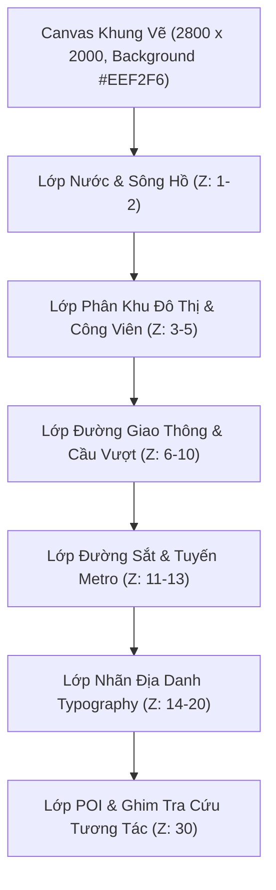

# ĐẶC TẢ KỸ THUẬT: HỆ THỐNG BẢN ĐỒ VECTOR & STUDIO BIÊN TẬP ĐA LỚP
# (VECTOR MAP ENGINE & MAP STUDIO SPECIFICATION)

> **Mã tài liệu:** `CORE-SPEC-017`  
> **Phiên bản:** `2.0.0`  
> **Trạng thái:** `Active / Implemented`  
> **Phạm vi áp dụng:** Hệ thống ứng dụng Bản đồ iPhone tang vật (`MapsApp`), Bộ công cụ quản trị (`/admin/map-studio`), và Động cơ bản đồ vector đa vụ án (`VectorMapCanvas`).

---

## 🗺️ 1. Tổng Quan & Mục Tiêu Kỹ Thuật

Trước phiên bản 2.0.0, ứng dụng Bản đồ trên điện thoại nạn nhân (`MapsApp`) sử dụng ảnh raster tĩnh `hanoi_master_map.png` (kích thước gốc $1237 \times 866\text{ px}$). Khi người chơi phóng to (zoom in) để soi các hẻm nhỏ hoặc bến bãi cảng sông, các nét vẽ bị vỡ pixel (blur/pixelated), đồng thời việc thêm mới địa điểm hoặc mở rộng sang các vụ án khác đòi hỏi phải vẽ lại ảnh Photoshop/Figma thủ công.

**Hệ thống Bản đồ Vector & Map Studio** giải quyết triệt để bài toán này với các mục tiêu:
1. **Độ phân giải vô cực (Infinite Vector Fidelity)**: Render toàn bộ địa hình đô thị (sông hồ, vùng quy hoạch, đại lộ, đường sắt, cầu vượt, nhãn chữ) bằng chuẩn vector SVG đa tầng trên canvas siêu rộng ($2800 \times 2000\text{ px}$).
2. **Visual Map Studio Web-based (`/admin/map-studio`)**: Giao diện đồ họa cho Game Master (GM) tự do vẽ, kéo thả node, nắn đường cong sông Hồng, dựng ray tàu hỏa, đặt mốc án mạng và xuất dữ liệu JSON trực tiếp vào Database.
3. **Bản đồ dân sự sạch sẽ & Chống lộ kịch bản (Zero-Leak Player View)**: Người chơi nhìn thấy một ứng dụng bản đồ giao thông bình thường trên điện thoại của nạn nhân. Các điểm mốc án mạng chỉ kích hoạt hiệu ứng ghim giọt nước đỏ khi người chơi gõ tìm kiếm đúng địa danh hoặc tra cứu nhật ký di chuyển.

---

## 🏛️ 2. Kiến Trúc Phân Lớp Vector (Multi-Layer Vector Hierarchy)

Dữ liệu bản đồ được chuẩn hóa theo mô hình `MapVectorData` (`types/map-vector.ts`), lưu trữ dưới dạng cấu trúc phân cấp tuần tự từ lớp nền đến lớp tương tác:



### Chi tiết các lớp phần tử:

| Lớp (Feature) | Interface | Quy cách đồ họa & Render logic |
| :--- | :--- | :--- |
| **Sông Hồ (Water)** | `WaterFeature` | Render bằng thẻ `<path>` SVG. Sông hở có thuộc tính `width`, hồ khép kín có `closed: true`. Sử dụng Catmull-Rom spline tạo đường bờ sông uốn lượn tự nhiên. |
| **Phân khu (Zones)** | `ZoneFeature` | Các mảng đa giác phân khu (cảng, khu công nghiệp, công viên, khu dân cư) với màu pastel dịu nhẹ (`fillColor`), viền mảnh (`strokeWidth: 1.5`), và độ trong suốt (`opacity: 0.85`). |
| **Đường sá (Roads)** | `RoadFeature` | Kiến trúc 3 tầng: **(1) Bóng đổ cầu vượt** (`isBridge: true`, stroke đen mờ), **(2) Viền casing** tạo lề đường, và **(3) Lòng đường** (`surface`) màu trắng/vàng. Hỗ trợ nét đứt cho đường ngõ hẻm (`dashed: true`). |
| **Đường sắt (Railways)**| `RailwayFeature` | Sinh tự động 2 ray thép song song (`railsPath`) kết hợp mảng thanh tà vẹt gỗ/bê tông (`sleepersPath`) vuông góc với trục đường ray. |
| **Nhãn chữ (Labels)** | `LabelFeature` | Văn bản SVG với tọa độ `(x, y)`, góc xoay `rotation`, khoảng cách ký tự `letterSpacing`, font Sans sắc nét. |
| **Điểm mốc (POIs)** | `PoiFeature` | Mốc án mạng và địa điểm điều tra. Gắn mã định danh, số phù hiệu, địa chỉ, số điện thoại và ghi chú trinh thám. |

---

## 📐 3. Thuật Toán Hình Học & Đường Cong Tự Nhiên

Được hiện thực hóa trong thư viện `lib/map-vector-utils.ts`:

### 3.1. Thuật toán Catmull-Rom sang Cubic Bezier (`pointsToSvgPath`)
Để bờ sông Hồng và các cung đường lớn không bị gấp khúc dạng đa giác gãy, hệ thống chuyển đổi chuỗi điểm điều khiển $P_i$ thành các đoạn cong bậc ba Bezier với tiếp tuyến trơn mượt:

$$\text{CP1} = P_1 + \frac{P_2 - P_0}{6}, \quad \text{CP2} = P_2 - \frac{P_3 - P_1}{6}$$

Hàm tự động xử lý trường hợp đường cong khép kín (`closed = true`) bằng cách chèn điểm đầu và điểm cuối lặp lại để tạo độ liên tục $C^1$ tại điểm giao.

### 3.2. Thuật toán Dựng Đường Sắt Kỹ Thuật (`generateRailwayPaths`)
Tự động tính toán hình học đường ray xe lửa từ một polyline tim đường:
1. **Ray song song**: Tại mỗi vector phân đoạn $\vec{v} = (\Delta x, \Delta y)$ có độ dài $L$, tính vector pháp tuyến đơn vị $\vec{n} = (-\Delta y/L, \Delta x/L)$. Nhân với khoảng cách bán kính $w/2$ để offset sang 2 bên trái/phải tạo thành 2 ray thép.
2. **Thanh tà vẹt (Sleepers)**: Duyệt chiều dài tích lũy theo chu kỳ `sleeperSpacing` (mặc định 12–16px). Tại mỗi bước, dựng một đoạn thẳng vuông góc dài vượt quá mép ray 2.5px sang hai phía.

### 3.3. Thuật toán Bắt Điểm Thông Minh (`snapPoint`)
1. **Từ tính điểm (Magnetic Snap)**: Ưu tiên bắt vào các đỉnh có sẵn trong bán kính $\le 14\text{ px}$.
2. **Lưới tọa độ (Grid Snap)**: Làm tròn tọa độ về bội số của lưới cấu hình (ví dụ $20\text{ px}$).

---

## 🛠️ 4. Map Studio Giao Diện Quản Trị (`/admin/map-studio`)

Map Studio cung cấp môi trường làm việc trực quan cho tác giả vụ án:
- **Thanh công cụ (Tools)**:
  - `Select` ($V$): Chọn phần tử, hiển thị bounding box, kéo di chuyển đỉnh hoặc toàn bộ object.
  - `Pan` ($H$): Kéo thả tự do khung nhìn bản đồ.
  - `Water` ($W$): Vẽ hồ nước khép kín hoặc sông hở.
  - `Road` ($R$): Vẽ các trục đường cao tốc, đại lộ, cầu vượt sông.
  - `Railway` ($T$): Vẽ tuyến đường sắt quốc gia hoặc metro trên cao.
  - `Zone` ($Z$): Phác thảo ranh giới phân khu địa chính.
  - `POI` ($P$): Đặt điểm mốc điều tra mới.
  - `Label` ($L$): Thêm nhãn địa danh trên bản đồ.
- **Thanh điều khiển nâng cao**:
  - Hỗ trợ Undo / Redo đa cấp.
  - Tùy chỉnh màu sắc trực quan, độ dày viền, bo góc mượt.
  - Thay đổi thứ tự hiển thị layer (Đưa lên trên / Đưa xuống dưới).
  - Tải file JSON, nạp bản sao lưu JSON, lưu trực tiếp vào Database server.

---

## 📱 5. Tích Hợp Vào Ứng Dụng Bản Đồ iPhone (`MapsApp` & `VectorMapCanvas`)

### 5.1. Cơ chế Khởi Tạo Tức Thì & Nạp Ngầm (Zero-Black-Screen)
- `MapsApp` khởi tạo state `customMapVector` ngay lập tức bằng dữ liệu seed đồng bộ từ `getDefaultMapVectorData('case_000')`.
- `useEffect` nạp ngầm từ API `/api/admin/map-vector?caseId=case_000`. Khi API trả về dữ liệu mới nhất đã biên tập từ Map Studio, component tự động hydrate đè lên mà không làm nhấp nháy giao diện.

### 5.2. Chế độ Xem Dân Sự (Player Civilian Clean View)
- Điểm mốc thông thường của người dân hiển thị hoàn toàn trong suốt hoặc điểm mờ tế vi, không hiển thị mã án, không có số thứ tự lộ liễu.
- Khi người chơi chọn một địa điểm từ thanh tìm kiếm, ghim giọt nước đỏ chuẩn iOS Maps (`MapPin` kèm bóng đổ) sẽ zoom nhẹ xuất hiện tại vị trí chính xác.
- Khi bật tính năng **Chỉ đường (Directions)**:
  - Ghim gốc A hiện vòng tròn xanh nhấp nháy (`animate-ping`).
  - Ghim đích B hiện vòng tròn đỏ cảnh báo.
  - Đường nối hành trình (Route polyline) kẻ đường màu xanh dương `#1A73E8` nối liền hai điểm kèm tính toán thời gian di chuyển thực tế.

---

## 🔌 6. API Contracts

### 6.1. `GET /api/admin/map-vector`
Lấy dữ liệu vector bản đồ thế giới mở rộng dùng chung.
- **Query Params**: `caseId` (tùy chọn; dùng để lọc hoặc highlight POI theo vụ án cụ thể).
- **Kho dữ liệu chuẩn**: `data/maps/world_vector_map.json` (tự động fallback sang `case_000_vector.json` để tương thích dữ liệu cũ).
- **Response**:
```json
{
  "success": true,
  "data": {
    "version": "3.0.0-osm-realworld-gps",
    "caseId": "world_map",
    "canvasWidth": 3600,
    "canvasHeight": 2800,
    "water": [...],
    "zones": [...],
    "roads": [...],
    "railways": [...],
    "pois": [...],
    "labels": [...]
  },
  "source": "file"
}
```

### 6.2. `POST /api/admin/map-vector`
Lưu dữ liệu vector bản đồ từ Map Studio vào kho bản đồ thế giới duy nhất.
- **Payload**:
```json
{
  "mapData": { ... }
}
```
- **Response**:
```json
{
  "success": true,
  "message": "Unified world map vector data saved successfully",
  "updatedAt": "2026-10-19T07:30:00.000Z"
}
```

---

## 🌐 7. Kiến Trúc Bản Đồ Thế Giới Dùng Chung Duy Nhất (Single Unified World Map Rule)

> [!IMPORTANT]
> **Nguyên tắc cốt lõi**: Dự án chỉ sử dụng **1 Bản đồ Thế giới Duy nhất (`data/maps/world_vector_map.json`)** cho toàn bộ các vụ án hiện tại và tương lai. Không tạo các file bản đồ địa hình rời rạc theo từng vụ án. Địa giới thế giới sẽ liên tục được mở rộng ra các phân khu mới.

### Quy tắc phân định Hạ Tầng vs Manh Mối Vụ Án:
1. **Hạ tầng địa lý chung (100% Shared Geography)**:
   - Sông hồ (`water`), đường cao tốc, đại lộ, hẻm phố (`roads`), cầu cống, đường sắt (`railways`) và phân khu đô thị (`zones`) là tài sản chung toàn cầu.
   - Khi Game Master (GM) thiết kế vụ án mới (Case #001, #002...), GM chỉ vẽ mở rộng thêm các nhánh đường hoặc mở thêm phân khu mới trên cùng một bản đồ thế giới.
2. **Quản lý POI & Tang vật theo Vụ án (`caseId` / `caseIds`)**:
   - Mỗi địa điểm (`PoiFeature`) có thể thuộc về một vụ án cụ thể (`caseId: 'case_000'`) hoặc mở cho nhiều vụ án (`caseIds: ['case_000', 'case_001']`), hoặc là địa điểm dân sự công cộng (bến xe, bệnh viện, nhà ga) dùng chung vĩnh viễn (`caseId: undefined`).
   - Ứng dụng điện thoại (`MapsApp`) trên thiết bị của từng vụ án sẽ hiển thị toàn cảnh thế giới và kích hoạt các manh mối phù hợp theo tiến trình điều tra.
3. **Tuyệt đối không dùng Mock / Hardcode Fallback**:
   - Ứng dụng nạp trực tiếp qua API `/api/admin/map-vector`. Không duy trì mảng `DEFAULT_CASE_LOCATIONS` hay seed tĩnh trong mã nguồn client.

