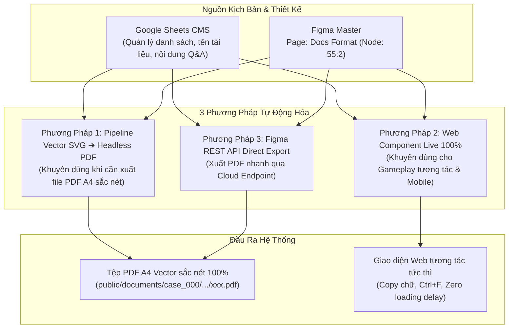

# Figma Design Workflow & Integration Guide (dect_project)

> **Mã tài liệu**: `docs/design/figma_workflow.md`  
> **Phiên bản**: v1.0.0 — Ngày ban hành: 10/10/2026  
> **Phạm vi áp dụng**: Toàn bộ UI/UX vụ án, màn hình điều tra thiết bị (Phone/PC), bảng chứng cứ, hiện trường và landing page.
>
> **Lưu ý (2026-10-29):** Mọi chỗ nhắc "Google Sheets CMS" trong tài liệu này là thiết kế cũ. Nội dung vụ án nay ở Supabase, biên tập qua Studio ([`../studio/authoring_guide.md`](../studio/authoring_guide.md)); quy trình Figma → asset vẫn áp dụng.

---

## 📌 1. Tổng Quan & Triết Lý Tích Hợp

Trong dự án **Detective Case System (`dect_project`)**, giao diện người dùng trinh thám đòi hỏi tính xác thực thị giác cực cao (Authentic Forensic & OS Simulation). Mọi chi tiết đồ họa từ màn hình hệ điều hành (iOS 9, Windows XP/7), giao diện ứng dụng con (Notes, Maps, Messages, Banking) đến hồ sơ tang vật đều bắt nguồn từ thiết kế trên **Figma Master**.

### 🎯 Nguyên tắc vàng: "Exact Asset First, Zero Pseudo-Mimicry"

1. **Không code giả lập CSS/SVG vu vơ**: Không tự chế icon, bố cục hoặc font chữ sai lệch khi đã có bản thiết kế chính thức trên Figma.
2. **Khai thác trực tiếp Asset Render từ Figma API**: Xuất ảnh độ phân giải cao (`@3x` / `@4x` PNG hoặc SVG gốc) từ Frame Figma để làm visual layer nền, sau đó phủ các vùng tương tác (**Interactive Hotspots**) hoặc form nhập liệu lên trên.
3. **Đồng bộ hóa 2 chiều Token & Content**: Màu sắc, khoảng cách, thông số kỹ thuật và ID bằng chứng phải khớp 100% giữa Figma, dữ liệu Studio (Supabase) và Codebase.

---

## 🔑 2. Cấu Hình Kết Nối & Thông Số Figma Dự Án

### 2.1. File Master Design & Access Token

- **Tên dự án Figma**: `XPLORE`
- **File Key**: `sIAYKRy84xtmgGs7oAqxg6`
- **URL Master File**: `https://www.figma.com/design/sIAYKRy84xtmgGs7oAqxg6/XPLORE`
- **Figma Personal Access Token (PAT)**: `<YOUR_FIGMA_ACCESS_TOKEN>`

### 2.2. Danh Mục Các Page & Frame Trọng Tâm Hiện Tại

| Phân Vùng          | Page ID  | Frame ID            | Tên Node / Mục Đích                                         | Kích Thước Viewport         | Trạng Thái Codebase                              |
| :----------------- | :------- | :------------------ | :---------------------------------------------------------- | :-------------------------- | :----------------------------------------------- |
| **Phone Master**   | `92:2`   | `92:300`            | iPhone Shell Container (Springboard iOS 9)                  | `375 x 667 pt` (Tỷ lệ 9:16) | ✅ Đã tích hợp (`iphone-frame.tsx`)              |
| **Lock Screen**    | `22:389` | `22:389` / `22:393` | Màn hình khóa (Lockscreen + Music Player + Slide to unlock) | `375 x 667 pt`              | ✅ Đã đồng bộ pixel-perfect (`iphone-frame.tsx`) |
| **Phone Keypad**   | `22:453` | `22:453`            | Bàn phím quay số tròn 75px & Nút gọi xanh                   | `375 x 667 pt`              | ✅ Đã triển khai (`phone-app.tsx`)               |
| **Recents**        | `22:582` | `22:582`            | Nhật ký cuộc gọi & Hộp thư thoại ghi âm                     | `375 x 667 pt`              | ✅ Đã triển khai (`phone-app.tsx`)               |
| **Messages App**   | `22:755` | `22:755`            | Danh sách hội thoại SMS & tin nhắn chưa đọc                 | `375 x 667 pt`              | ✅ Đã đồng bộ layout 86px (`messages-app.tsx`)   |
| **Notes App**      | `92:2`   | `92:550`            | Giao diện ghi chú giấy vàng-kem iOS 9                       | `375 x 667 pt`              | ✅ Đã tích hợp (`notes-app.tsx`)                 |
| **Maps App**       | `92:2`   | `92:623`            | Bản đồ điều tra hiện trường vụ án                           | `375 x 667 pt`              | ✅ Đã tích hợp (`maps-app.tsx`)                  |
| **Hanoi Map Data** | `92:2`   | `96:9215`           | Vector / Graphic Bản đồ Hà Nội chi tiết                     | Scale canvas                | ✅ Đã xuất bản (`hanoi_master_map.png`)          |

---

## 🛠️ 3. Kiến Trúc Kết Nối MCP Server (`figma-mcp-server`)

Hệ thống AI Agent trong dự án được tích hợp trực tiếp công cụ `figma` thông qua giao thức MCP (Model Context Protocol).

### 3.1. Cấu hình MCP Client (`mcp_config.json`)

Vị trí file cấu hình: `C:/Users/Dell/.gemini/config/mcp_config.json`

```json
{
  "mcpServers": {
    "figma": {
      "command": "npx",
      "args": [
        "-y",
        "@tothienbao6a0/figma-mcp-server",
        "--figma-api-key=<YOUR_FIGMA_ACCESS_TOKEN>",
        "--stdio"
      ]
    }
  }
}
```

### 3.2. Bộ Công Cụ Hỗ Trợ (Figma MCP Tools)

Khi làm việc với Figma qua Agent, các tool khả dụng gồm:

- `get_figma_data`: Lấy cấu trúc DOM tree JSON của toàn bộ file hoặc node cụ thể (`nodeId`).
- `download_figma_images`: Tự động tải hình ảnh render của các frame/vector theo `nodeId` với định dạng `png` / `svg` / `jpg` và tỷ lệ `scale` (1x, 2x, 3x).
- `get_figma_variables`: Trích xuất danh sách Design Tokens / Variables (màu sắc, spacing, radii).
- `check_design_code_sync`: Đối chiếu sự sai lệch giữa mã nguồn CSS/Tailwind và file thiết kế.

---

## ⚡ 4. Quy Trình Xuất Bản & Tích Hợp (Step-by-Step Workflow)

Khi cần đưa một màn hình hoặc thành phần đồ họa mới từ Figma vào Web App:

```
[BƯỚC 1: Xác định Frame/Node] ➔ [BƯỚC 2: Export Asset @3x] ➔ [BƯỚC 3: Tối ưu & Lưu vào public/]
                                                                       │
[BƯỚC 5: Kiểm tra Type & Commit] 🠔 [BƯỚC 4: Code Hotspots & State] 🠔───┘
```

### Bước 1: Lấy Node ID trên Figma

1. Mở file Figma trên trình duyệt hoặc app.
2. Chọn Frame cần lấy.
3. Sao chép liên kết (Copy link to selection): URL sẽ có dạng `...node-id=92-300...` (Node ID là `92:300`).

### Bước 2: Xuất Asset chất lượng cao (3x PNG / SVG)

Có 2 cách thực hiện:

#### Cách A: Dùng Figma REST API (Tự động hóa qua cURL / Node Script)

```bash
# 1. Gọi lấy Image URL từ Figma REST API
curl -H "X-Figma-Token: <YOUR_FIGMA_ACCESS_TOKEN>" \
  "https://api.figma.com/v1/images/sIAYKRy84xtmgGs7oAqxg6?ids=92:300&scale=3&format=png"

# 2. Tải file từ URL do Figma trả về
curl -o "public/images/cases/case_000/phone/figma_ios9_home_screen.webp" "<URL_DOWNLOAD>"
```

> **Lưu ý về Rate Limit**: Figma REST API giới hạn số request/phút. Đối với các file đã tải về local, ưu tiên sử dụng lại asset local, không spam gọi API liên tục.

#### Cách B: Xuất thủ công trên Figma Client

- Chọn Frame ➔ Tab **Export** (bên phải) ➔ Đặt `PNG 3x` hoặc `SVG` ➔ Bấm **Export** ➔ Lưu vào thư mục tương ứng (chuyển sang WebP cho runtime).

### Bước 3: Tuân Thủ Phân Định Lưu Trữ (`Asset Storage Boundary`)

- **Tài nguyên phục vụ runtime game**: Lưu tại `public/images/cases/case_000/phone/` (hoặc `public/images/cases/case_000/...`).
- **Tài nguyên nghiên cứu, nháp, moodboard**: Lưu tại `docs/cases/case_000/02_photos/`.
- Đăng ký asset vào [`docs/cases/case_000/02_photos/ASSET_CATALOG.md`](../cases/case_000/02_photos/ASSET_CATALOG.md).

### Bước 4: Kỹ Thuật "Interactive Hotspots Layer"

Để giao diện giống 100% Figma mà vẫn click chuyển app mượt mà:

1. Render ảnh nền Figma làm background tuyệt đối (`object-cover` hoặc ``).
2. Định vị các nút tương tác tàng hình bằng tỷ lệ phần trăm (`% top/left/width/height`) theo lưới của màn hình:

```tsx
{
  /* Nền ảnh Figma render 3x */
}
;

{
  /* Lưới Hotspots tương tác trùng khít tọa độ icon */
}
<div className="absolute inset-0 grid grid-cols-4 grid-rows-4 pt-[11.5%] px-[6.5%] gap-x-[7%] gap-y-[4%]">
  <button
    onClick={() => setActiveApp("messages")}
    className="w-full h-full cursor-pointer rounded-2xl hover:bg-white/10 active:scale-90 transition-transform"
    title="Tin nhắn (Messages)"
  />
  {/* Các nút tương tác tiếp theo... */}
</div>;
```

---

## 🎨 5. Quy Chuẩn Màu Sắc & Typography Đồng Bộ

Hệ màu và font chữ trích xuất từ Master Figma (`iOS 9 Legacy Design System`):

### 5.1. Bảng màu hệ điều hành iOS 9

- **Messages Green**: `#28CA36` (Gradient: `#60E450` ➔ `#28CA36`)
- **System Blue**: `#0A84FF`
- **Notification Red**: `#FF3B30`
- **Calendar Red Header**: `#FF3B30`
- **Music Fuchsia**: `#FF2D55` ➔ `#FA114F`
- **Notes Yellow/Cream**: Nền kem kẻ sọc cam `#FBF8EB` / Header `#E69138`
- **Frosted Glass Blur**: `bg-white/25 backdrop-blur-md`
- **Dock Translucent Background**: `bg-white/35 backdrop-blur-2xl border-t border-white/20`

### 5.2. Font chữ & Hiệu ứng

- **Font gia đình**: `-apple-system, BlinkMacSystemFont, "SF Pro Text", "Helvetica Neue", sans-serif`
- **Số giờ Lockscreen**: Font extralight `text-[64px] tracking-tighter drop-shadow-[0_2px_8px_rgba(0,0,0,0.7)]`
- **Slide to unlock shimmer**: CSS text gradient animation `linear-gradient(90deg, rgba(255,255,255,0.25), rgba(255,255,255,0.98), rgba(255,255,255,0.25))`

---

## 📋 6. Checklist Kiểm Thử Trước Khi Hoàn Thành (Definition of Done)

Trước khi commit bất kỳ thay đổi nào liên quan đến Figma:

- [ ] Ảnh asset đã được nén tối ưu (WebP hoặc PNG nén, dung lượng hợp lý < 3MB).
- [ ] Tọa độ hotspot tương tác bấm thử hoạt động chính xác trên cả Mobile và Desktop.
- [ ] Tuân thủ **Mobile UX Rule**: Không sử dụng `autoFocus` tự động bật bàn phím ảo.
- [ ] Kiểm tra lỗi TypeScript: Chạy `npx tsc --noEmit` đạt 0 lỗi.
- [ ] Tạo Git commit theo chuẩn Conventional Commits (ví dụ: `feat(iphone): sync ... with figma design`).

---

## 📑 7. Kiến Trúc Tự Động Hóa Xuất Tài Liệu & Hồ Sơ Vụ Án (Figma Document & PDF Automation Pipeline)

Trong quá trình phát triển các vụ án trinh thám, việc quản lý và xuất bản hàng chục biên bản lời khai (`LK-...`), hồ sơ lý lịch (`HS-...`), báo cáo pháp y (`BC`) và hợp đồng (`HĐ`) từ Figma vào Web App có thể được tự động hóa qua 3 phương pháp cốt lõi:



### 7.1. Phương Pháp 1: Pipeline Vector SVG ➔ Headless PDF (Khuyên dùng cho hồ sơ in ấn & PDF Viewer)

- **Nguyên lý giải quyết lỗi nhòe/mờ**:
  - Tránh tuyệt đối việc lấy ảnh raster PNG nhúng vào trang PDF (sẽ gây vỡ hạt khi zoom > 100%).
  - Kéo file vector gốc dạng **SVG** (`download_figma_images` với đuôi `.svg`).
  - Sử dụng engine Chromium không đầu (**Playwright / Puppeteer**) đọc SVG và in ra file PDF với chuẩn in ấn **A4 (210 x 297 mm / 595.28 x 841.89 pt)**, cờ `printBackground: true`.
- **Luồng tự động hóa hoàn toàn từ Google Sheets**:
  1. Script đọc Google Sheet để lấy danh sách tên tài liệu (ví dụ: `LK-Vũ`, `LK-Mai`, `HS-01`).
  2. Duyệt cây node Figma (Node `55:2` - `Docs Format`) thông qua MCP / API để tự động tìm Node tương ứng theo thuộc tính `name`.
  3. Kéo SVG của từng node về thư mục tạm.
  4. Playwright render và đóng gói thành file `.pdf` vector hoàn chỉnh vào đúng thư mục đích: `public/documents/case_000/<phase>/`.
  5. **Chất lượng**: Độ sắc nét tuyệt đối (zoom 1000% không vỡ hạt), dung lượng tối ưu, chuẩn tỷ lệ trang in hành chính Việt Nam.

### 7.2. Phương Pháp 2: Web Component Live 100% (Khuyên dùng cho Gameplay trinh thám & Mobile)

- **Nguyên lý**: Tách bạch triệt để giữa **Khung trang giấy (Skin/Shell)** và **Nội dung (Data)**.
- **Cấu tạo**:
  - **Khung giao diện (HTML/Tailwind CSS)**: Thiết kế 1 lần duy nhất theo đúng layout chuẩn của Figma (viền chỉ đôi, quốc hiệu, tiêu ngữ, căn lề hành chính, nốt gập giấy A4, con dấu đỏ PC02 nghiêng -5 độ, chữ ký tay mẫu dạng ảnh nhỏ 10KB dùng chung).
  - **Nội dung sống (Live Hydration)**: Bơm trực tiếp dữ liệu câu hỏi, câu trả lời, họ tên nhân chứng từ Google Sheets Live CMS.
- **Lợi thế vượt trội**:
  - **Siêu nhẹ**: Payload chỉ từ `3 KB – 5 KB` JSON thay vì `300 KB – 1 MB` file ảnh/PDF (nhẹ hơn 50 - 100 lần, tiết kiệm băng thông và RAM).
  - **Tương tác gameplay sâu**: Người chơi có thể bôi đen chữ, highlight câu khai nghi vấn, dùng `Ctrl + F` tìm manh mối, click vào câu trả lời để đối chất trực tiếp.
  - **Sửa án tức thì**: Game Master (GM) chỉnh sửa tình tiết vụ án trên Google Sheets, người chơi F5 là thấy ngay lập tức mà không cần Designer phải xuất lại file.
  - **Responsive Mobile hoàn hảo**: Không phải dùng ngón tay zoom ảnh A4 khổ lớn trên màn hình điện thoại nhỏ.

### 7.3. Phương Pháp 3: Figma REST API Direct Export (Native Endpoint)

- **Nguyên lý**: Sử dụng trực tiếp endpoint chính thức của Figma:
  ```http
  GET https://api.figma.com/v1/images/:fileKey?ids=:nodeId&format=pdf
  Header: X-Figma-Token: <FIGMA_ACCESS_TOKEN>
  ```
- **Cơ chế**: Máy chủ Figma tự động render node thành file PDF và trả về link tải tạm thời (S3 URL).
- **Đặc điểm**: Đơn giản, không phụ thuộc vào trình duyệt Chromium cục bộ, nhưng bị giới hạn bởi tốc độ render của máy chủ Figma và thời hạn tồn tại của link tạm thời.

---

### 7.4. Bảng So Sánh & Hướng Dẫn Ra Quyết Định (Decision Matrix)

| Tiêu chí                    | Phương Pháp 1: Vector SVG ➔ Headless PDF                                | Phương Pháp 2: Web Component Live 100%          | Phương Pháp 3: Figma REST API Direct          |
| :-------------------------- | :---------------------------------------------------------------------- | :---------------------------------------------- | :-------------------------------------------- |
| **Định dạng đầu ra**        | File `.pdf` vector thực tế                                              | DOM HTML / CSS React Component                  | File `.pdf` do Figma server render            |
| **Độ nét khi Zoom**         | 🌟 Sắc nét tuyệt đối (Vector 100%)                                      | 🌟 Sắc nét tuyệt đối (HTML Font)                | 🌟 Sắc nét (Vector PDF)                       |
| **Dung lượng tải**          | ~200 KB – 900 KB / file                                                 | **Siêu nhẹ: ~3 KB – 5 KB** JSON                 | ~200 KB – 800 KB / file                       |
| **Tốc độ mở trong game**    | Cần nạp PDF viewer                                                      | **Mở tức thì 0.05s** (Zero lag)                 | Cần nạp PDF viewer                            |
| **Khả năng tương tác**      | Chỉ đọc, cuộn trang                                                     | Bôi đen, Ctrl+F, click đối chất                 | Chỉ đọc, cuộn trang                           |
| **Tính linh hoạt kịch bản** | Phải chạy lệnh build lại file                                           | **Cập nhật tức thì 0s từ Google Sheets**        | Phải chạy lệnh build lại file                 |
| **Trường hợp áp dụng**      | Người chơi tải hồ sơ về máy, in ấn giấy, hoặc lưu trữ pháp y chính thức | **Gameplay phá án trực tiếp trên Web & Mobile** | Xuất nhanh kiểm tra thiết kế, trao đổi nội bộ |
