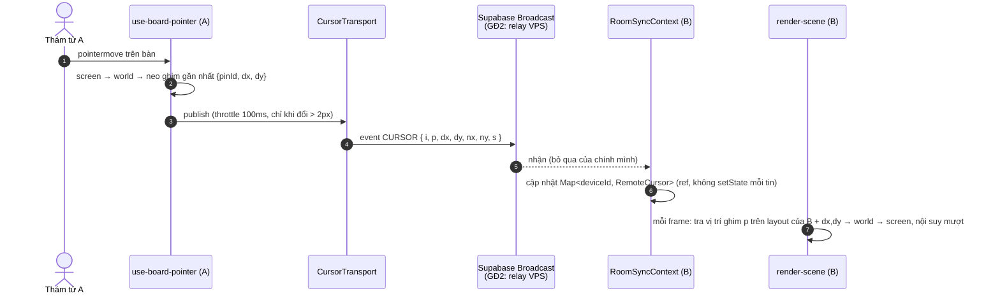

# 📋 Kế Hoạch Triển Khai: Con Trỏ Thời Gian Thực Trong Phòng Chơi Nhóm (Live Multiplayer Cursors)

> ⛔ **Trạng thái (2026-10-25): CHƯA GIAO.** Chỉ bắt đầu sau khi B13 xong, đã push + smoke test production và đã xác nhận gói Supabase (Free/Pro). Xem `docs/WORKTREE_PLAN.md` mục "Việc tiếp theo", bước 7.

> **Mục tiêu:** 2–6 thám tử cùng phòng thấy con trỏ chuột của nhau trên bàn điều tra theo thời gian thực, trỏ đúng cùng một ghim dù khác thiết bị/zoom. Trên điện thoại, chạm để chỉ điểm (dùng lại ping có sẵn).
>
> **Hai giai đoạn:**
>
> - **Giai đoạn 1 (làm ngay):** Supabase Realtime Broadcast trên kênh `room:${code}` có sẵn, lưu lượng đã giảm để nằm trong trần gói Free.
> - **Giai đoạn 2 (chỉ lên kế hoạch, triển khai sau):** relay WebSocket tự host trên VPS cho riêng con trỏ + ping, khi nhiều phòng chơi đồng thời chạm trần Supabase.
>
> Quy ước: `AGENTS.md` (global + dự án). Chỉ dùng **pnpm**. Typecheck: `pnpm lint` (`tsc --noEmit`).

---

## 0. Ràng buộc đã kiểm (2026-10-25)

| Ràng buộc                                                                                                                                           | Nguồn                                                                                                                       | Hệ quả cho thiết kế                                                                 |
| --------------------------------------------------------------------------------------------------------------------------------------------------- | --------------------------------------------------------------------------------------------------------------------------- | ----------------------------------------------------------------------------------- |
| Supabase Realtime: Free 100 tin/giây, Pro 500 tin/giây, **tính chung cả project**; vượt → bị ngắt kết nối                                           | [Realtime Limits](https://supabase.com/docs/guides/realtime/limits)                                                         | Không gửi 28 lần/giây như bản nháp. Trần ~10 lần/giây/người, chỉ khi di chuyển      |
| Tính tiền: 1 broadcast = 1 tin gửi + 1 tin cho **mỗi** người nhận                                                                                   | [Realtime Messages](https://supabase.com/docs/guides/platform/manage-your-usage/realtime-messages)                          | Phòng 6 người: mỗi lần gửi tính ×6 → phải gửi ít, payload nhỏ                       |
| Presence Free: 20 tin/giây                                                                                                                          | Realtime Limits                                                                                                             | Không dùng presence cho con trỏ; chỉ dùng Broadcast                                 |
| Kênh đã có: `supabase.channel("room:"+code, { broadcast: { self: false }, presence: { key: deviceId } })`                                           | `components/investigation/room-sync-context.tsx:338-345`                                                                    | Dùng lại kênh, không mở kênh mới                                                    |
| Presence đã mang `nickname`, key = `deviceId`                                                                                                       | `room-sync-context.tsx:347-376`                                                                                             | Payload con trỏ **không** gửi nick/màu; bên nhận tra từ presence                    |
| Ping chỉ điểm đã có: `broadcastPing` / event `DETECTIVE_PING`                                                                                       | `room-sync-context.tsx:199-238`, `:378`                                                                                     | Chạm trên mobile dùng lại ping, không làm "ripple" mới                              |
| Vị trí ghim **khác nhau giữa desktop và mobile** (lưới riêng + `board_config.position.{desktop,mobile}`), khung bảng phụ thuộc kích thước container | `components/investigation/mindmap/canvas/pin-builder.ts:23-32, 91-101`; `getInnerBoardBounds` (`hero-interactive/utils.ts`) | Tọa độ 0–1 thuần sẽ lệch. Phải neo theo ghim gần nhất                               |
| Bảng vẽ bằng canvas, vòng lặp `requestAnimationFrame` riêng; pan/zoom ở `zoomRef`/`panRef`                                                          | `components/investigation/hero-interactive.tsx:224, 385-404`                                                                | Vẽ con trỏ **trong** vòng lặp canvas, không dùng overlay DOM (tránh trượt khi zoom) |
| Trang có 3 bề mặt: bàn điều tra, khung xem tài liệu, `DossierCanvasBoard`                                                                           | `app/(investigation)/evidence/web/page.tsx:134, 909-911`                                                                    | Payload có `surface`; chỉ vẽ khi cùng bề mặt                                        |

---

## 1. Kiến trúc



**Điểm mấu chốt:**

1. **Neo theo ghim:** gửi `p` = id ghim gần nhất (trong bán kính `ANCHOR_RADIUS` world px) + độ lệch `dx, dy` đã chia cho kích thước ghim. Bên nhận lấy vị trí ghim `p` trên layout **của mình** rồi cộng độ lệch. Không có ghim gần → dùng `nx, ny` (0–1 theo bounds bàn).
2. **`CursorTransport` là interface:** UI và pointer chỉ gọi `publish()` / `subscribe()`. Giai đoạn 1 cài bằng Supabase Broadcast; giai đoạn 2 thay bằng relay VPS mà không sửa UI.
3. **State con trỏ nằm trong ref** (`Map`), không `setState` mỗi tin → không re-render React 10 lần/giây × 5 người. Canvas đọc ref mỗi frame.

---

## 2. Giai đoạn 1 — Supabase Broadcast (làm ngay)

### 2.1. File

| File                                                               | Việc                                                                                                                                                      |
| ------------------------------------------------------------------ | --------------------------------------------------------------------------------------------------------------------------------------------------------- |
| `lib/types/room.ts`                                                | Thêm `CursorWirePayload`, `RemoteCursor`, `CursorSurface`, `CURSOR_PALETTE`, hằng số `CURSOR_*`                                                           |
| `lib/realtime/cursor-transport.ts` (mới)                           | Interface `CursorTransport` + `createSupabaseCursorTransport(channel)`                                                                                    |
| `components/investigation/room-sync-context.tsx`                   | Tạo transport trên kênh hiện có; giữ `remoteCursorsRef`; dọn khi `presence leave` + timeout; expose `publishCursor`, `remoteCursorsRef`, `colorForDevice` |
| `components/investigation/hero-interactive/cursor-anchor.ts` (mới) | Hàm thuần: `anchorFromWorld(world, pins, bounds)`, `worldFromAnchor(anchor, pins, bounds)`                                                                |
| `components/investigation/hero-interactive/use-board-pointer.ts`   | Trong `handlePointerMove` (dòng ~271): chỉ `pointerType === "mouse"` hoặc `"pen"` → tính anchor → `publishCursor` (throttle)                              |
| `components/investigation/hero-interactive/render-scene.ts`        | Vẽ con trỏ đồng đội sau lớp ghim: mũi bút + thẻ tên giấy cũ, nội suy                                                                                      |
| `components/investigation/hero-interactive.tsx`                    | Truyền `remoteCursorsRef` vào render loop (cạnh `customPinsRef`, dòng ~357)                                                                               |
| `e2e/live-cursor.spec.ts` (mới)                                    | E2E 2 trình duyệt                                                                                                                                         |

### 2.2. Payload (dây)

```ts
// lib/types/room.ts
export type CursorSurface = "board" | "doc" | "desk";

export interface CursorWirePayload {
  i: string; // deviceId người gửi
  s: CursorSurface; // bề mặt đang trỏ
  p?: string; // id ghim neo (nếu có)
  dx?: number; // lệch so với tâm ghim, đơn vị = bề rộng ghim, làm tròn 2 số lẻ
  dy?: number;
  nx?: number; // fallback: 0–1 theo bounds bàn, làm tròn 3 số lẻ
  ny?: number;
  h?: 1; // ẩn (chuột rời bàn / tab ẩn) — gửi 1 lần
}

export interface RemoteCursor extends CursorWirePayload {
  receivedAt: number;
  // vị trí đang vẽ, để nội suy
  drawX?: number;
  drawY?: number;
}
```

- Không gửi `nick`, `color`, `isTouch`, `timestamp`. Nick lấy từ `members` (presence), màu `colorForDevice(i)`.
- Kích thước JSON mục tiêu < 80 byte.

### 2.3. Hằng số

```ts
export const CURSOR_THROTTLE_MS = 100; // ~10 lần/giây tối đa
export const CURSOR_MIN_MOVE_PX = 2; // không gửi nếu di chuyển < 2px màn hình
export const CURSOR_STALE_MS = 3500; // mờ dần rồi xóa
export const CURSOR_LERP = 0.25; // nội suy mỗi frame
export const ANCHOR_RADIUS_WORLD = 220; // tìm ghim neo trong bán kính này
export const CURSOR_PALETTE = [
  "#C0392B",
  "#2980B9",
  "#D35400",
  "#27AE60",
  "#8E44AD",
  "#7F6A4E",
];
```

Màu: `CURSOR_PALETTE[hash(deviceId) % length]`, ổn định giữa các lần vào phòng.

### 2.4. Bước làm (mỗi bước 1 commit)

| Bước    | Việc                                                                                                                                                                                                                                                                                                       | Done khi                                                                                                                      |
| ------- | ---------------------------------------------------------------------------------------------------------------------------------------------------------------------------------------------------------------------------------------------------------------------------------------------------------- | ----------------------------------------------------------------------------------------------------------------------------- |
| **LC1** | Type + hằng số + `cursor-anchor.ts` (hàm thuần) + unit test nhỏ cho `anchorFromWorld` ↔ `worldFromAnchor` (khứ hồi trên 2 layout khác nhau trả về cùng ghim)                                                                                                                                               | `pnpm lint` sạch; test hàm thuần pass                                                                                         |
| **LC2** | `cursor-transport.ts`: interface `{ publish(p), subscribe(cb) → unsubscribe, close() }` + bản Supabase (`channel.send({ type: "broadcast", event: "CURSOR", payload })`, `channel.on("broadcast", { event: "CURSOR" })`). Throttle + `MIN_MOVE` nằm trong `publish`, gửi tin cuối cùng khi dừng (trailing) | Không có lệnh `channel.send` cho con trỏ ngoài file này                                                                       |
| **LC3** | `room-sync-context.tsx`: tạo transport sau khi subscribe kênh; `remoteCursorsRef: Map`; xóa khi nhận `h: 1`, khi `presence leave` (handler dòng ~371) và khi quá `CURSOR_STALE_MS` (dọn trong render loop, không cần `setInterval`); đóng transport khi `leaveRoom` / unmount                              | Rời phòng → không còn listener `CURSOR`; Map rỗng                                                                             |
| **LC4** | `use-board-pointer.ts`: gửi khi `roomCode` có, `pointerType` là `mouse`/`pen`, `document.visibilityState === "visible"`. `pointerleave` / `visibilitychange → hidden` → gửi `{ h: 1 }` một lần. **Touch: không phát con trỏ**; chạm giữ nguyên hành vi hiện tại (ping qua `broadcastPing`)                 | Kéo pan trên mobile không sinh tin `CURSOR`                                                                                   |
| **LC5** | `render-scene.ts`: vẽ con trỏ (mũi bút máy) + thẻ tên giấy cũ cạnh mũi; nội suy `drawX += (target − drawX) * CURSOR_LERP`; mờ dần 500ms cuối trước khi xóa; chỉ vẽ cursor có `s === "board"`. Màu có tương phản ≥ 4.5:1 với chữ thẻ tên                                                                    | Zoom/pan bên nhận: con trỏ đồng đội vẫn nằm trên đúng ghim                                                                    |
| **LC6** | Bề mặt khác: khung tài liệu (`s: "doc"`) và `DossierCanvasBoard` (`s: "desk"`) **chưa vẽ con trỏ** trong giai đoạn này; trên bàn hiện chip nhỏ "Nam đang xem tài liệu" khi đồng đội ở bề mặt khác                                                                                                          | Chip đúng tên, biến mất khi đồng đội quay lại bàn                                                                             |
| **LC7** | Đo lưu lượng: log đếm tin `CURSOR` gửi/giây trong dev (`process.env.NODE_ENV === "development"`)                                                                                                                                                                                                           | 1 người rê chuột liên tục ≤ 10 tin/giây; đứng yên = 0                                                                         |
| **LC8** | E2E + docs                                                                                                                                                                                                                                                                                                 | Xem 2.5; cập nhật `docs/core_specs/11_group_play_realtime_spec.md` (event `CURSOR`, payload, ngân sách tin) và `CHANGELOG.md` |

### 2.5. E2E — `e2e/live-cursor.spec.ts`

Dùng 2 `browser.newContext()` (A desktop 1440×900, B mobile 375×812 hoặc desktop thứ 2), cùng mã phòng.

1. A rê chuột tới ghim nghi phạm → B: trong vòng 1s, render loop có cursor của A neo vào đúng `pinId` (đọc qua hook test `window.__cursorDebug` chỉ bật khi `NODE_ENV !== "production"`).
2. B zoom 2× và pan → cursor A vẫn neo cùng `pinId`, sai số ≤ 4px màn hình so với vị trí ghim + lệch.
3. A ở desktop, B ở layout mobile → cursor A vẫn ở cùng ghim (kiểm chứng neo theo ghim, không phải tọa độ thô).
4. A đứng yên 2s → số tin `CURSOR` A gửi trong 2s đó = 0 (đếm qua `page.on("websocket")` hoặc bộ đếm debug).
5. A đóng tab → B: cursor A biến mất trong ≤ 4s (presence leave hoặc stale).
6. B ở mobile kéo pan → A không nhận tin `CURSOR` từ B.

### 2.6. Ngân sách tin (để biết khi nào cần giai đoạn 2)

- 1 phòng 6 người, giả sử tối đa 3 người cùng rê chuột: 3 × 10 = **30 tin gửi/giây**; tính tiền ×6 người nhận ≈ 180 tin/giây.
- Trần Free 100 tin/giây **cho cả project** → khoảng 2–3 phòng hoạt động đồng thời là chạm trần (tùy Supabase đếm tin gửi hay cả tin nhận vào trần — kiểm bằng trang Realtime Reports khi chạy thật).
- **Tín hiệu chuyển giai đoạn 2:** Realtime Reports cho thấy đỉnh > 70% trần, hoặc có log client bị ngắt kết nối do rate limit, hoặc quota tin/tháng dùng > 70%.

---

## 3. Giai đoạn 2 — Relay WebSocket trên VPS (CHỈ LÊN KẾ HOẠCH, triển khai sau)

> Không làm trong đợt này. Ghi lại để khi chạm trần chỉ việc thực hiện.

### 3.1. Phạm vi

- Chỉ chuyển **con trỏ (`CURSOR`) + ping (`DETECTIVE_PING`)** sang relay. Đây là dữ liệu dùng xong bỏ, không cần lưu.
- **Giữ ở Supabase:** Postgres, Auth, presence thành viên, `STATE_PATCH`, `postgres_changes` của `game_rooms`. Không tự host Supabase/Postgres (quá nặng: >10 container, tự backup/nâng cấp).

### 3.2. Thiết kế

| Thành phần     | Quyết định                                                                                                                                                                                                                                                |
| -------------- | --------------------------------------------------------------------------------------------------------------------------------------------------------------------------------------------------------------------------------------------------------- |
| Server         | Node `ws` (hoặc `uWebSockets.js` nếu cần hiệu năng), 1 file, giữ `Map<roomCode, Set<socket>>` trong RAM, chỉ chuyển tiếp (fan-out), không lưu gì                                                                                                          |
| Triển khai     | Container Docker riêng `dect_cursor_relay` trong `docker-compose.yml`, `mem_limit: 128m`, `cpus: 0.25`, `restart: unless-stopped`; bind `127.0.0.1:3010`                                                                                                  |
| Edge           | Caddy (`deploy/caddy/Caddyfile`) thêm route `wss://<domain>/rt` → `127.0.0.1:3010`; TLS do Caddy lo                                                                                                                                                       |
| Xác thực       | Client gửi `access_token` Supabase khi kết nối; relay xác minh JWT bằng `SUPABASE_JWT_SECRET` (hoặc JWKS) và kiểm người dùng thuộc phòng (gọi Supabase REST 1 lần lúc join, cache 5 phút). Khách chưa đăng nhập: token ký riêng do app cấp khi join phòng |
| Chống lạm dụng | Giới hạn mỗi socket 15 tin/giây, payload ≤ 256 byte, tối đa 8 socket/phòng, tối đa N phòng/IP; vượt → đóng socket                                                                                                                                         |
| Client         | `createRelayCursorTransport(url, token, roomCode)` cài cùng interface `CursorTransport`; tự kết nối lại (backoff 1s→30s); **relay chết → tắt con trỏ im lặng, game chạy bình thường**                                                                     |
| Bật/tắt        | Biến `NEXT_PUBLIC_CURSOR_TRANSPORT=supabase\|relay`; mặc định `supabase`                                                                                                                                                                                  |
| Mở rộng sau    | Nhiều instance → thêm Redis pub/sub giữa các relay (chưa cần với 1 VPS)                                                                                                                                                                                   |
| Giám sát       | Endpoint `/healthz` cho healthcheck Docker; log số phòng/socket/tin mỗi phút                                                                                                                                                                              |

### 3.3. Lợi / hại

- **Lợi:** không giới hạn số tin theo gói, không tốn thêm tiền, độ trễ thấp hơn (không qua máy chủ Supabase), payload tự quyết.
- **Hại:** tự vận hành (cập nhật, bảo mật, rate-limit); chạy chung VPS với app production nên phải giới hạn tài nguyên; thêm một điểm lỗi (đã giảm bằng cơ chế tắt im lặng); cần cấu hình Caddy + secret JWT trên VPS.

### 3.4. Bước khi triển khai (sau)

| Bước | Việc                                                                                            |
| ---- | ----------------------------------------------------------------------------------------------- |
| R1   | `services/cursor-relay/` (server + Dockerfile) + unit test xác thực/rate-limit                  |
| R2   | `docker-compose.yml` + Caddy route + `.env.example` (`CURSOR_RELAY_URL`, `SUPABASE_JWT_SECRET`) |
| R3   | `createRelayCursorTransport` + cờ `NEXT_PUBLIC_CURSOR_TRANSPORT`                                |
| R4   | Chuyển `DETECTIVE_PING` sang cùng transport                                                     |
| R5   | E2E 2.5 chạy lại với `relay`; thử tắt container relay → game vẫn chơi được                      |
| R6   | Cập nhật `docs/core_specs/06_cicd_deployment_guide.md`, `11_group_play_realtime_spec.md`        |

---

## 4. Ngoài phạm vi

- Con trỏ trên khung xem tài liệu PDF và `DossierCanvasBoard` (chỉ có chip "đang xem").
- Chỉ đường/vẽ cùng nhau (annotation chung) — đã có `AnnotationStroke` riêng.
- Thư viện nội suy spline (`perfect-cursors`): chưa thêm dependency; dùng lerp trong render loop. Xem lại nếu chuyển động chưa đủ mượt.
